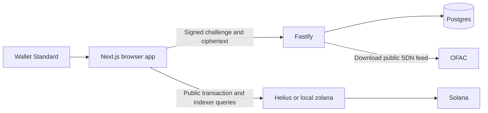

# Darkbid

Darkbid is a devnet-only Solana OTC negotiation workspace. It supports encrypted listings and offers, seller acceptance with terms encrypted to both parties, and a browser vault with SDK-backed local decryption. Test deposits, confidential sends and withdrawals are gated by preview configuration. Sends and withdrawals use the Helius browser prover. Deal funding, atomic seal, automated refunds, fee collection and treasury transactions are unavailable.

## Run locally

Use Node 24, pnpm 11.25, and Docker Compose. For localnet, also install the [Privacy Rings CLI](https://github.com/helius-labs/privacy-rings#install-the-cli). Run from this repository root.

```sh
pnpm install --frozen-lockfile
cp apps/api/.env.example apps/api/.env
cp apps/web/.env.example apps/web/.env.local
openssl rand -hex 32
```

Set the generated value as `JWT_SECRET` in the API environment. To use devnet vault sync, configure a dedicated browser-safe Helius RPC URL in the web environment. For localnet, set both network variables to `localnet` and leave the public RPC URL blank. The OTC API requires outbound HTTPS access to the OFAC feed for screening.

```sh
pnpm dev
```

Open [Darkbid](http://localhost:3000), [API health](http://localhost:4000/health), or [OpenAPI UI](http://localhost:4000/docs). The launcher starts local Postgres and, in localnet mode, zolana. See the environment templates for running infrastructure separately and [the runbook](docs/RUNBOOK.md) for shutdown and deployment.

```sh
pnpm lint
pnpm typecheck
pnpm test
pnpm build
```

## Architecture



- [Architecture](docs/ARCHITECTURE.md)
- [SDK notes and known gaps](docs/SDK_NOTES.md)
- [Threat model](docs/THREAT_MODEL.md)
- [Privacy and retention](docs/PRIVACY.md)
- [Runbook and devnet deployment commands](docs/RUNBOOK.md)
